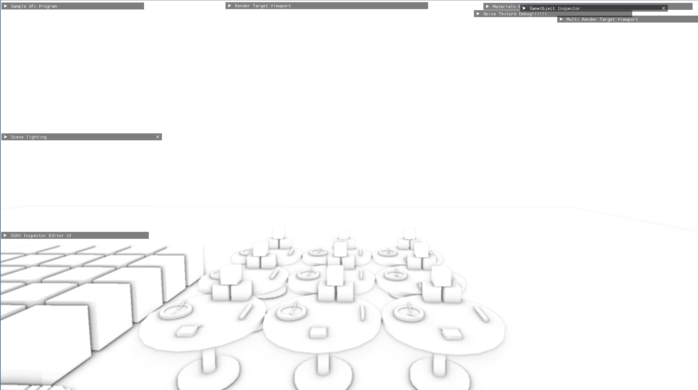

# Screen-Space Ambient Occlusion (SSAO)

A real-time Screen-Space Ambient Occlusion implementation built in C++ and OpenGL as a graphics subsystem using [PreglRenderer framework](https://github.com/Conqster/PreglRenderer).
The project explores sampling-based occlusion estimation, configurable sampling distributions, coordinate-space transformations, and post-processing techniques through an interactive deferred-rendering pipeline.

<table align = "center"> 
  <tr>
      <td>
          
      </td>
      <td>
          
      </td>
  </tr>
</table>

## Features
* **SSAO Pipeline** implements hemisphere sampling and depth-based occlusion estimation in GLSL, with configurable kernel sizes of up to 256 samples.
* **Sampling Distributions** supports linear through quintic radial scaling to investigate how sample placement affects occlusion quality and visual noise.
* **Geometry Buffers** implements alternative view-space and world-space G-Buffer pipelines for evaluating geometry representations and their effect on occlusion calculations.
* **Noise and Filtering** uses a tiled random-noise texture to vary sampling orientation and includes box and Gaussian blur passes to reduce high-frequency sampling noise.
* **Interactive Debugging** integrates Dear ImGui controls for adjusting sampling parameters and inspecting intermediate rendering outputs in real time.
* Shader Hot Reloading supports iterative GLSL development without restarting the application.

### Demonstration
<table align = "center"> 
  <tr>
      <th>
        <a href="https://youtu.be/VFLzbclscFo">
      </th>
  </tr>
  <tr>
      <td align="center"> <i>Sample video (youtube)</i></td>
  </tr>
</table>
          
## Technical Overview
The rendering pipeline separates scene geometry, ambient occlusion estimation, and final lighting into distinct passes.

* **Geometry pass:** Generates position and normal buffers containing the surface information required for occlusion estimation.
* **Occlusion pass:** Generates a hemisphere sampling kernel, projects sample positions into screen space, and compares their depths against the scene geometry to estimate occlusion.
* **Filtering pass:** Applies configurable post-processing to reduce sampling noise.
* **Lighting pass:** Combines the occlusion result with the scene's lighting to produce the final image.
### Sampling Distribution
The sampling kernel supports configurable radial distributions using a power function:


<table align="center">
  <tr>
    <td>
      $s_i = s_{\min} + (s_{\max}-s_{\min}) \left(\frac{i}{N}\right)^p$
    </td>
  </tr>
</table>


The exponent \(p\) controls how sample indices are distributed across the radial interval. Linear through quintic mappings can be compared interactively, allowing the effect of radial sample placement on occlusion detail and noise to be explored.

```cpp
float scale = static_cast<float>(i) / kernelSize;
scale = glm::mix(minDist, maxDist, glm::pow(scale, distribution_pow));
v *= scale;
```

### Artefact Mitigation

A tiled random-noise texture varies the sampling orientation across the screen to reduce visible grid-aligned patterns. A depth-bias parameter helps mitigate self-occlusion artefacts, while box and Gaussian blur passes provide alternative approaches to smoothing high-frequency noise.

### Implementation Architecture
* **SSAO:** Manages sampling-kernel generation, noise-texture generation, and algorithm parameters.
* **SSAOProgram:** Coordinates rendering passes, GPU parameter updates, scene setup, and interactive controls.
* **GLSL shaders:** Implement geometry-buffer generation, occlusion estimation, filtering, and deferred lighting.
* **PreglRenderer:** Provides the underlying rendering framework and supporting graphics infrastructure.

<!-- The SSAO module is maintained separately and integrated with PreglRenderer through Git submodules. -->
The SSAO module is developed separately utilising [PreglRenderer](https://github.com/Conqster/PreglRenderer) through Git submodules.

## Technologies
* **Languages:** C++, GLSL
* **Graphics:** OpenGL, deferred rendering, framebuffer objects, textures, multiple render targets
* **Mathematics:** GLM, vector and matrix transformations, nonlinear sampling distributions
* **Tools:** CMake, Dear ImGui, GLFW, RenderDoc

## Related Projects
**[PreglRenderer](https://github.com/Conqster/PreglRenderer):** The underlying graphics & app framework.
